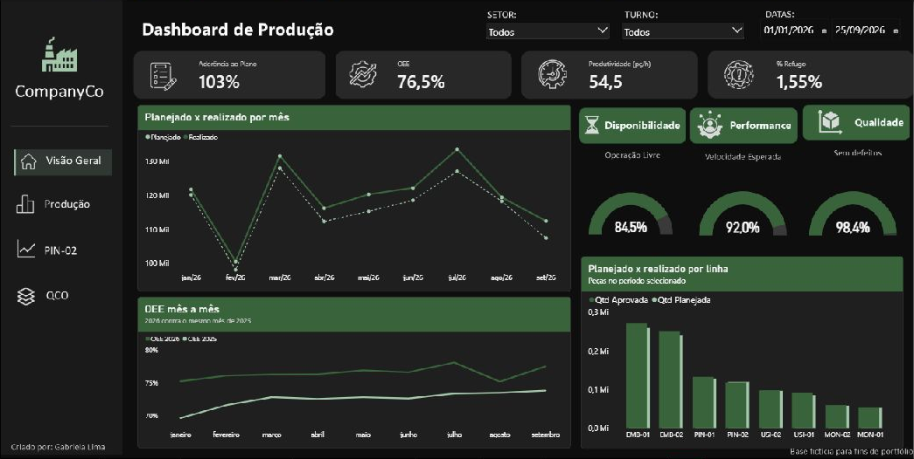
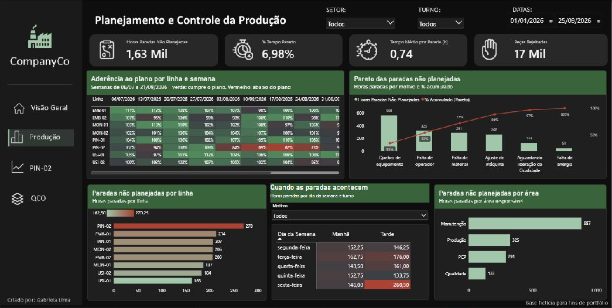
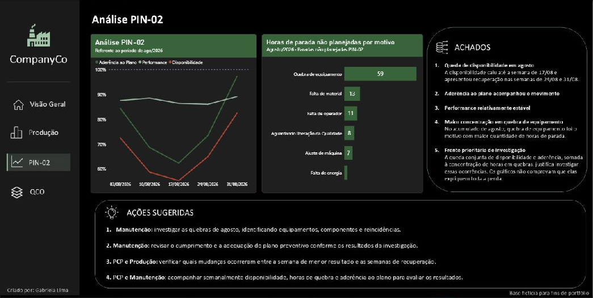
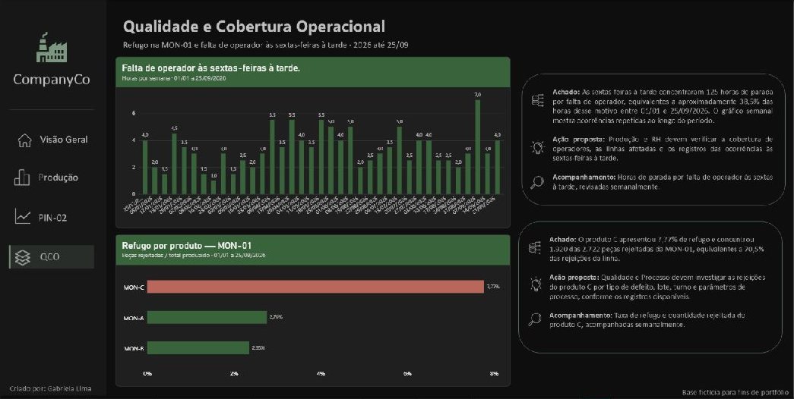

# Painel de Produção: aderência ao plano, OEE e paradas

Projeto de portfólio em análise de dados, desenvolvido em **Power BI**.
Os dados são **simulados** e não representam uma empresa real.

## Pergunta de negócio

Onde a produção perde eficiência e o que deve ser tratado primeiro?

O painel atende a gestores, ao PCP (Planejamento e Controle da Produção), à Manutenção e à Qualidade.

## O que o painel mostra

### Página Gestor
Visão geral da produção: aderência ao plano, OEE (eficiência global), produtividade e percentual de refugo. Mostra a evolução mensal do OEE, o comparativo com o ano anterior e as quantidades planejadas e realizadas por mês e por linha.

### Página PCP e Manutenção
Mostra a aderência ao plano por linha e semana, as paradas não planejadas por área responsável e por linha, o Pareto dos motivos e a distribuição das paradas por dia da semana e turno. Os filtros permitem explorar setor, turno, período e motivo.

### Página PIN-02
Detalha a linha PIN-02, relacionando aderência ao plano, performance e disponibilidade ao longo das semanas. Também mostra as horas de parada não planejadas por motivo.

### Página QCO — Qualidade e Cobertura Operacional
Aprofunda dois pontos de atenção: falta de operador às sextas-feiras à tarde e percentual de refugo por produto na linha MON-01.

### Dicas de ferramenta
O painel inclui um comparativo semanal e uma dica com as quantidades aprovadas e rejeitadas por produto. Essas páginas de apoio aparecem ao passar o mouse sobre os visuais associados.

## Principais achados

1. **Linha PIN-02, agosto de 2026:** a disponibilidade e a aderência ao plano caíram até a semana de 17/08, com recuperação nas semanas de 24 e 31/08. As quebras de equipamento somaram cerca de 59 horas no recorte exibido. A performance ficou relativamente estável.
2. **Linha MON-01, de 01/01 a 25/09/2026:** o produto C apresentou 7,77% de refugo e concentrou 1.920 das 2.722 peças rejeitadas da linha (70,5%).
3. **Sextas-feiras à tarde, de 01/01 a 25/09/2026:** a falta de operador somou 125 horas, aproximadamente 38,5% das horas desse motivo no período.
4. **Manutenção, de 01/01 a 25/09/2026:** responde por cerca de 54% das horas paradas não planejadas.

As páginas PIN-02 e QCO apresentam hipóteses de investigação, ações sugeridas e formas de acompanhamento.

## Indicadores

Valores calculados sobre toda a base (30/09/2024 a 25/09/2026). Os prints mostram recortes de 2026, portanto os números exibidos podem diferir.

| Indicador | Valor | Como é calculado |
|---|---|---|
| Aderência ao plano | 98,7% | Peças aprovadas divididas pelas peças planejadas |
| OEE (eficiência global) | 74,0% | Disponibilidade × Performance × Qualidade |
| Disponibilidade | 83,4% | Horas produzidas divididas pelas horas programadas |
| Performance | 90,1% | Total produzido dividido pelo que seria produzido na velocidade ideal |
| Qualidade | 98,4% | Peças aprovadas divididas pelo total produzido |

## Dados e ferramentas

- Base simulada com 4 setores, 8 linhas de produção e 2 turnos, de 30/09/2024 a 25/09/2026 (104 semanas).
- Tabelas: Produção (7.968 registros), Paradas (24.478 registros), Calendário, Linha, Turno e Motivo.
- Conferência dos dados: as horas programadas menos as horas produzidas são iguais à soma das horas paradas (diferença zero).
- Ferramentas: Power BI (Power Query, modelagem de dados, medidas em DAX e visualização) e Excel.
- Os seis arquivos Excel da base estão na raiz deste repositório.

## Como abrir o painel

1. Baixe o repositório em **Code → Download ZIP** e extraia os arquivos.
2. Abra [dash_producao_v3.pbix](dash_producao_v3.pbix) no Power BI Desktop.
3. Para atualizar os dados, ajuste os caminhos das fontes no Power Query para a pasta em que você salvou os arquivos Excel.

O arquivo PBIX contém os dados importados. As planilhas permitem consultar a base e atualizar o modelo.

O [resumo em PDF](Projeto_Painel_Producao.pdf) foi mantido como material complementar da versão anterior; os prints e as descrições acima correspondem à versão atual.

## Limitações

- Os dados são simulados: os resultados demonstram o método e não representam uma empresa real.
- As causas apontadas são hipóteses e precisam ser confirmadas na prática.
- O OEE considera como perda todas as paradas, inclusive as planejadas. Sem as paradas planejadas, o OEE seria de 81,0%.
- Não há metas oficiais nem custos: as faixas de cor e os prazos são sugestões da autora.

## Autora

**Gabriela Lima**
[LinkedIn](https://www.linkedin.com/in/gabriela-lima-dados/)
